# VORA CITY · by JAG

**A landscape mobile open-world game set in Vora City** — the fictional West-African-inspired city built in this
repository. Create your own protagonist, wake up in your mansion in North Heights, meet your household and walk out
into a living city. Built in APK milestones; **APK 1 – "App + Home"** is the current build and is produced by GitHub
Actions on every push (`Actions → Android APK → Artifacts`). See **[docs/GAME.md](docs/GAME.md)** for the game design,
controls, architecture and road-map.

| | |
|---|---|
| 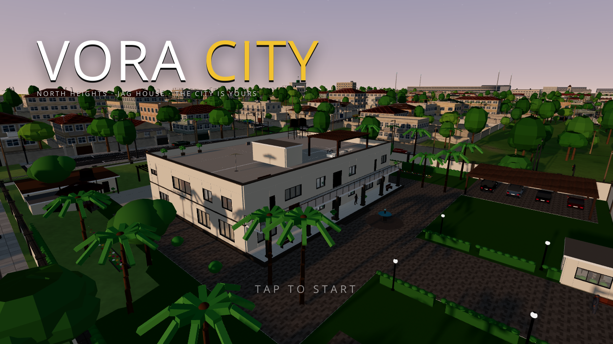 *live title — the camera orbits your compound* | 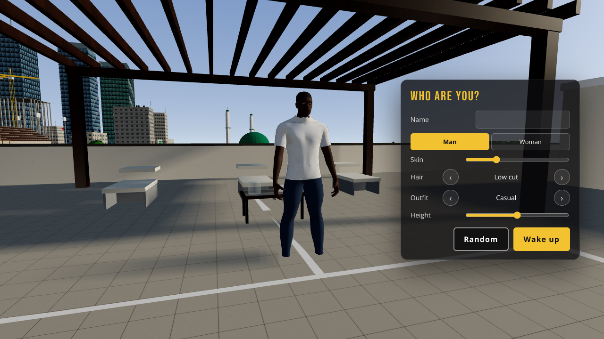 *character creation on the roof terrace* |
| 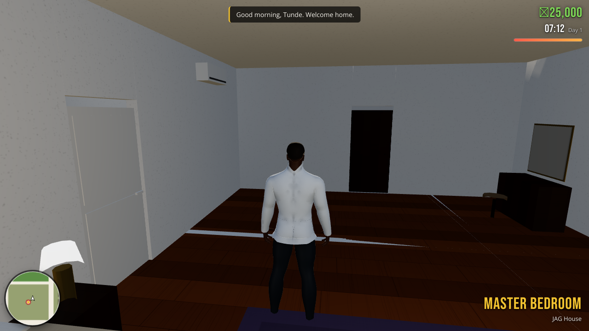 *Day 1, 07:12 — wake up in the master bedroom* | 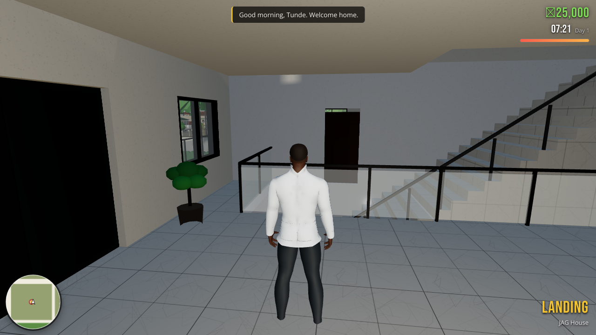 *the landing and stairs* |
| 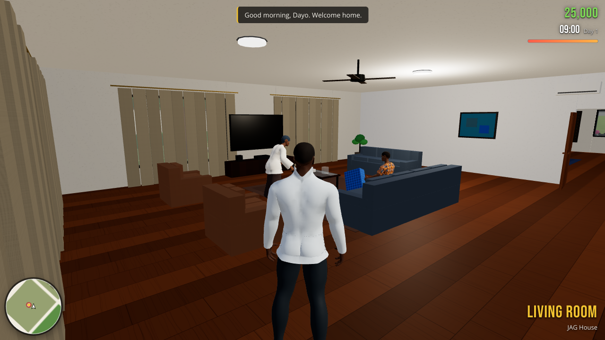 *living room — housekeeper sweeping, a friend on the sofa* | 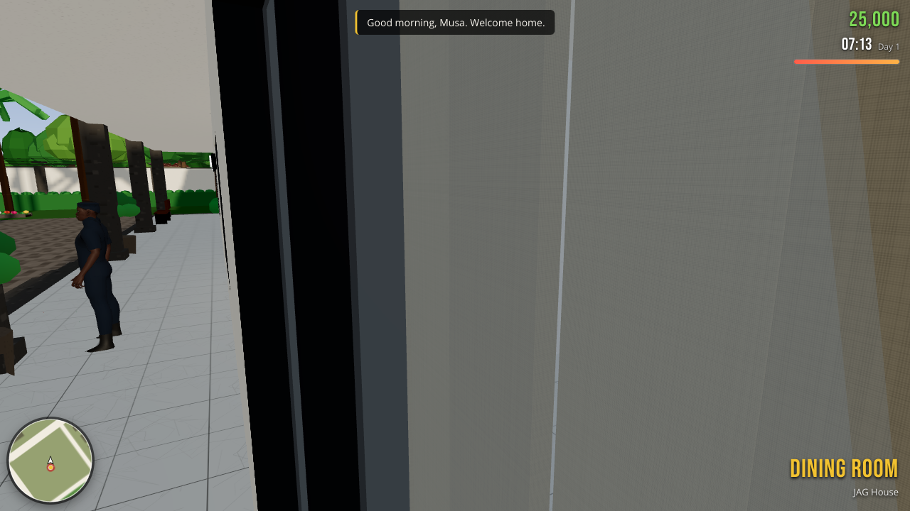 *dining room — the steward* |
| 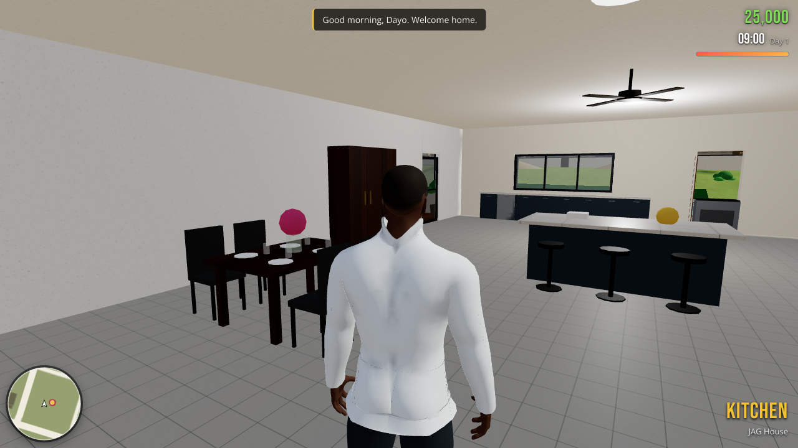 *kitchen* | 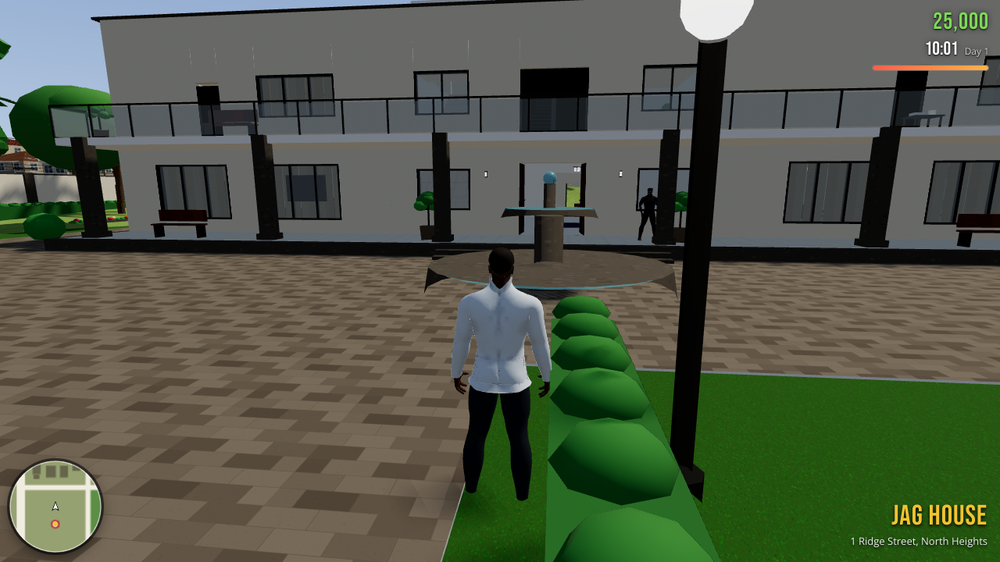 *forecourt fountain and the owner's cars* |
| 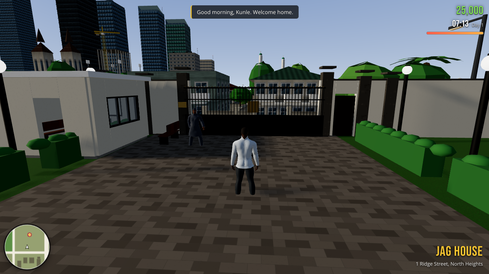 *the gate, the gateman and the gatehouse* | 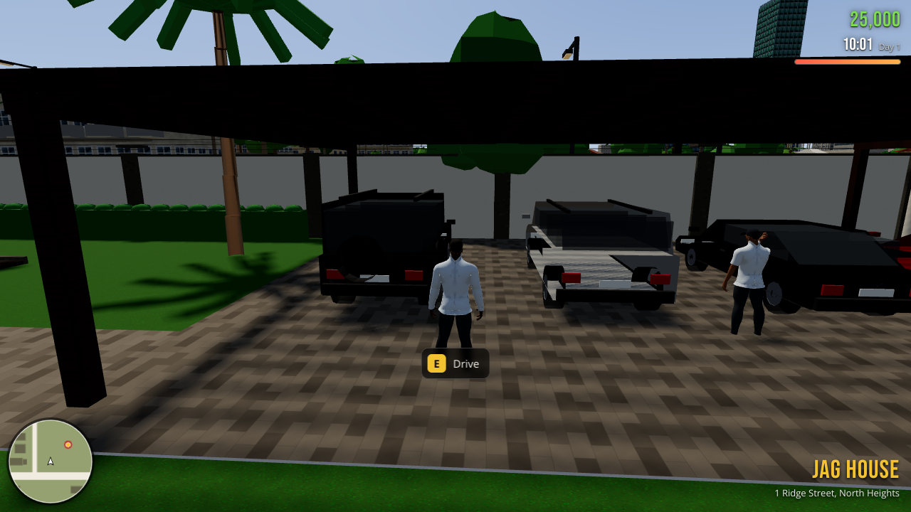 *carport — Range Rover, G-Wagon, saloon, pickup, danfo, okada* |
| 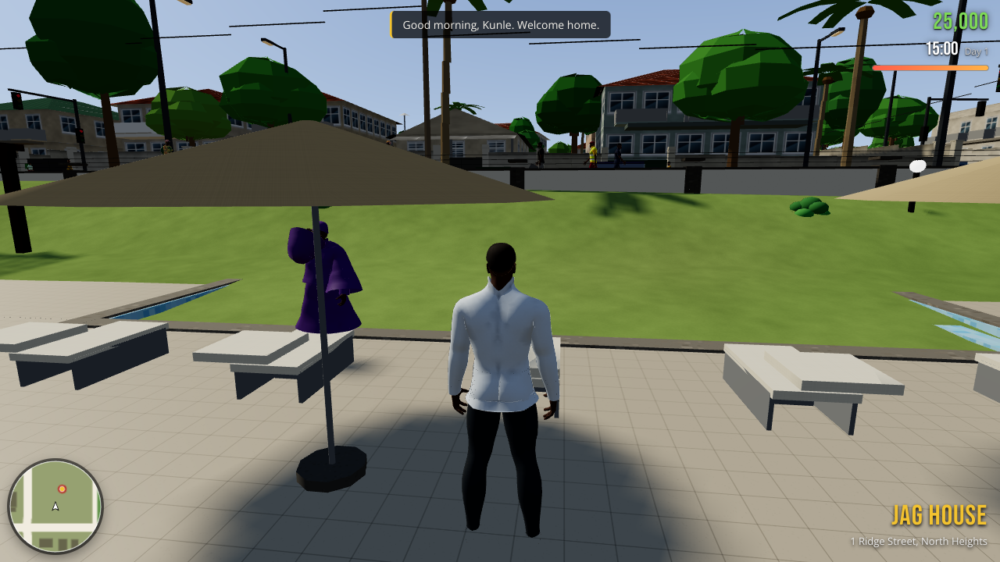 *pool deck* | 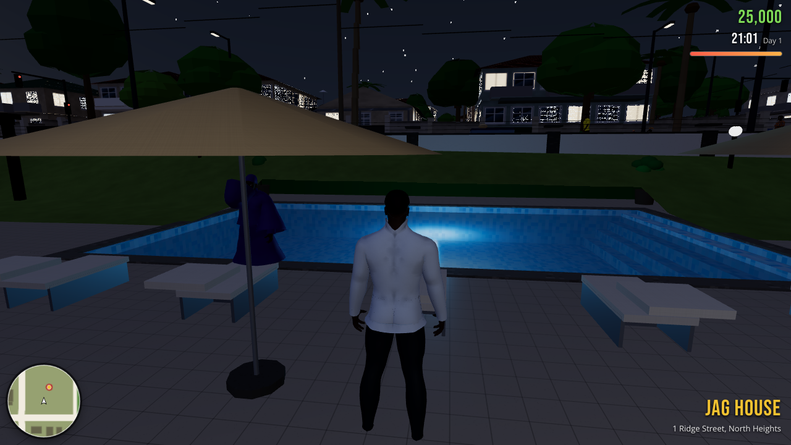 *21:00 — pool lights, the city's windows come on* |
| 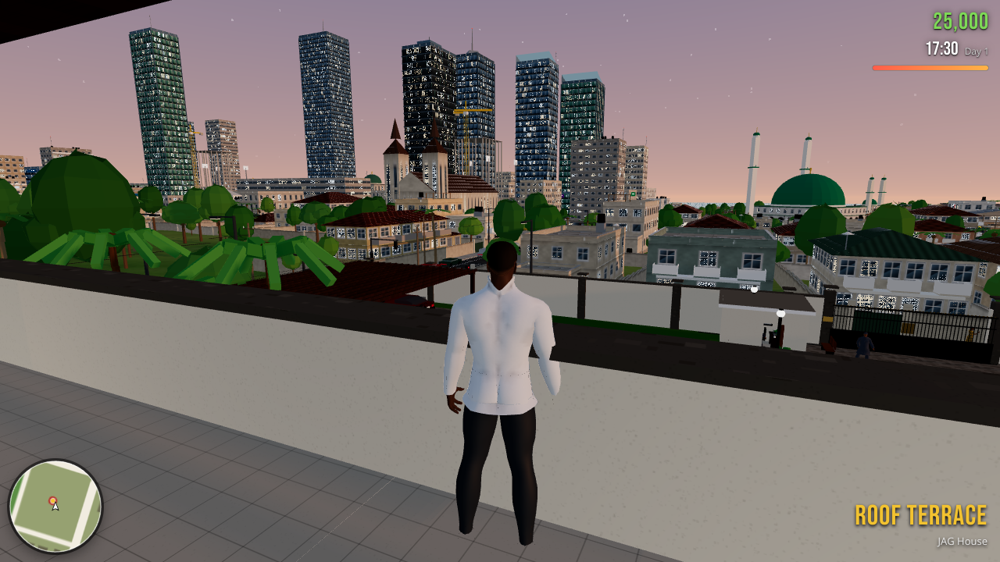 *roof terrace at dusk* | 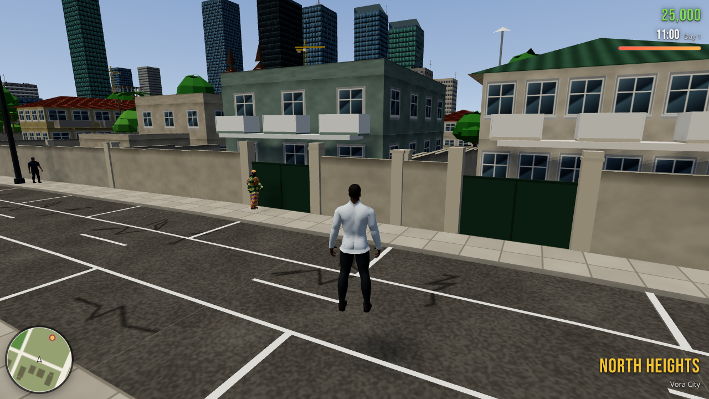 *outside the gate — Garden Terrace, North Heights* |

```
JAG logo → loading → live title → New game: create your character → wake up at home → explore
```

* **Runs on any phone** — Lite / Standard / High presets (auto-detected), landscape, touch stick + buttons; also
  playable in a desktop browser (`npm run dev`, WASD + mouse).
* **Your home** — JAG House, 1 Ridge Street: two storeys, roof terrace, pool, fountain, gatehouse, carport, staff
  quarters, generator house; working doors, sliders, fans, TVs, beds (sleep → next day), fridge (eat), wardrobes
  (change outfit), the main gate and the generator ("Up NEPA").
* **Your household** — gateman, security, driver, housekeeper, cook, gardener, steward, night guard, a friend and a
  guest, cast from the Phase 2 population, each at their post doing their job; walk up and talk to them.
* **HUD** — radar, ₦ cash, clock + day, health, place cards, interaction prompts; pause menu with save and settings.
* **Android** — Capacitor shell (`android/`, `com.jag.voracity`), immersive landscape, JAG splash and icon; the debug
  APK (~55 MB) is built by `.github/workflows/android.yml`.

---

# V-WORLD · Vora City (the world under the game)

A continuous, data-driven 3D city for the fictional West-African-inspired country **V**. This repository holds the
*physical foundation* of the world — terrain, water, a connected road network, blocks and parcels, ~1,260 buildings in
six districts, 23 landmarks and ~13,000 pieces of street detail — as a real project (generator + data + renderer),
not a single HTML file.


| | |
|---|---|
|  |  |
|  |  |

## How it is built

```
generator/  (Node, TypeScript)  ──►  data/city.json  ──►  src/app/ (Vite + three.js viewer)
```

1. **`npm run generate`** runs the deterministic, seeded generator (`generator/index.ts`) and bakes
   `data/city.json` (≈2.7 MB): terrain parameters, water, districts, the road graph (nodes/edges with classes, names,
   heights, bridges, roundabouts), blocks, parcels, buildings (massing + facade/roof/feature descriptions), landmarks
   (with camera views) and props. Every entity has a **stable id, type, position and district**, so gameplay,
   traffic, NPCs or an economy layer can be attached later without touching the world.
2. **`npm run dev`** serves the viewer. It builds all geometry at load time from the JSON (procedural texture atlas,
   chunked merged meshes, instanced props, LOD/culling, a single camera-following shadow map, time-of-day sky) — no external
   assets are downloaded.

### Construction order (matches the master plan)

| Stage | Where | What |
|---|---|---|
| 1 Audit | `docs/REPORT.md` | findings on the legacy demo (`legacy/`) and what was replaced |
| 2 Layout | `generator/config.ts` | district polygons, authored skeleton roads, reserved landmark sites, roundabouts, bridges |
| 3 Roads | `generator/graph.ts`, `generator/roads.ts`, `src/shared/roadgeom.ts`, `src/app/world/roads.ts` | planar graph (intersections, snapping, duplicate removal), hierarchy (arterial / secondary / local / lane / service / waterfront), junction geometry, markings, crossings, kerbs, medians, drains, bridges |
| 4 Blocks & parcels | `generator/blocks.ts`, `generator/parcels.ts` | faces → blocks, corridor insets (building line), frontage-aware subdivision, setbacks, fences/gates, addresses |
| 5 Major architecture | `generator/landmarks.ts` | 23 authored landmarks sized to their sites (City Hall, Meridian Tower, Grand Market, Stadium, Cathedral, Mosque, Royal Court, Port, Terminal, Bridge, …) |
| 6 Neighbourhood architecture | `generator/archetypes.ts`, `generator/buildings.ts` | 49 archetypes with parcel-relative massing, facades, roofs and features (balconies, canopies, columns, tanks, AC units, signs, …) |
| 7 Public spaces | `generator/landmarks.ts` (`parkProps`), `generator/props.ts` | squares, parks, playgrounds, pitches, markets, quays |
| 8 Street detail | `generator/props.ts`, `src/app/world/props.ts` | lamps, trees, benches, bins, signals, stop/street-name/directional signs, bus shelters, bollards, parking bays, vendors, kiosks, wires, manholes, roadworks, construction sites, vehicles |
| 9 Refinement | `src/app/atlas.ts`, `src/app/materials.ts`, `src/app/sky.ts` | consistent materials, lighting, time-of-day, night windows and lamp pools |
| 10 Optimisation & verification | `src/app/main.ts`, `tests/`, `scripts/screenshot.mjs` | quality presets, chunking, instancing, LOD, headless render + tests |

## Characters & crowds (Phase 2)

Real skinned humans, not boxes. A **CC0 MakeHuman base body** (`assets/source/makehuman/`) is morphed per character
(sex, age, build, height, African macro targets), re-posed into the **Mixamo rig convention** taken from the supplied
`assets/source/mixamo/xbot.fbx` (65 `mixamorig:*` bones + jaw and two eye joints), given painted skin, procedural
eyes, hair carved from the scalp (cornrows, twists, braids, afro, coils, low cut, bun …) or head-wear (gele, fila,
hijab, scarf, cap, beret, hard hat), a wardrobe **cut from the body** (33 garment builders: iro & buba, agbada,
kaftan, senator, boubou, abaya, gown, dress, wrapper, school and work uniforms, hi-vis, jeans, polos, sandals …)
textured with procedural West-African prints (ankara wax prints, kente, aso-oke, adire) and 18 props (head trays of
tomatoes / oranges / bread, sachet-water basins, yam baskets, sacks, briefcases, handbags, Ghana-must-go bags, school
bags, baby wraps, walking sticks, jerrycans, buckets …). Everything is generated by `characters/` as glTF 2.0
(`.gltf` + `.bin`, three LOD nodes each) with a shared 9-clip procedural animation library.

| | |
|---|---|
| 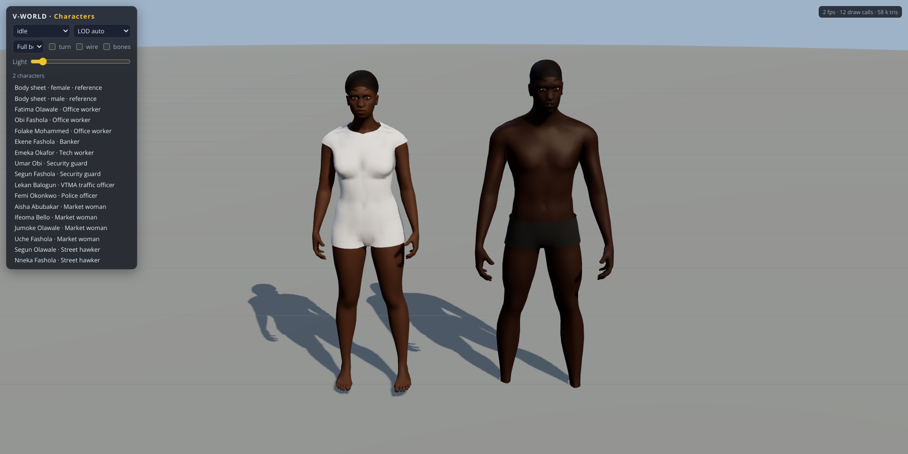 *body sheet (bind pose)* | 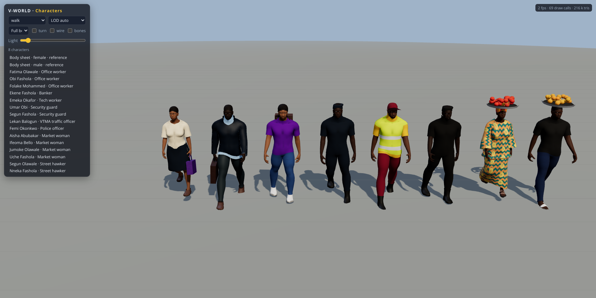 *walk cycle, retargeted per height* |
| 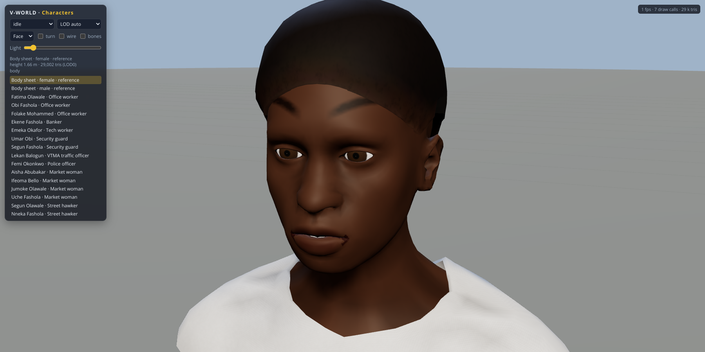 | 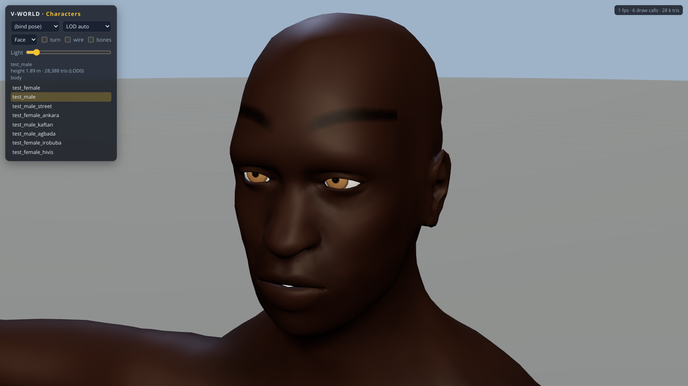 |
| 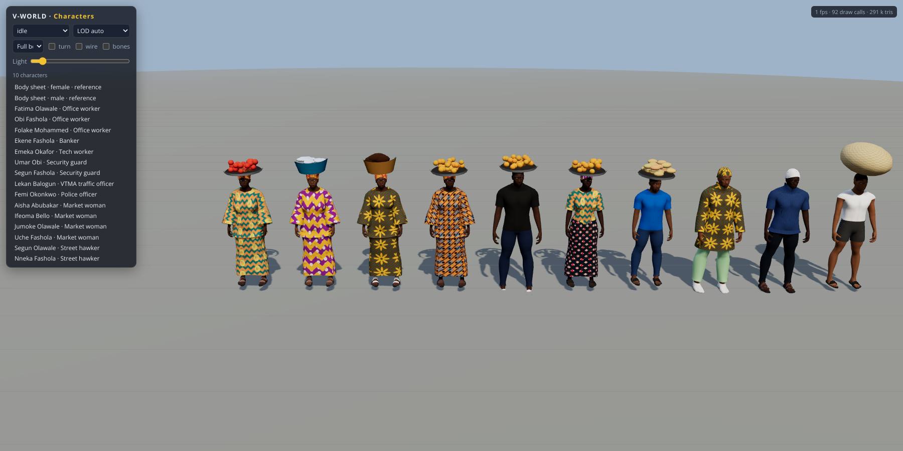 *Market Quarter cast* | 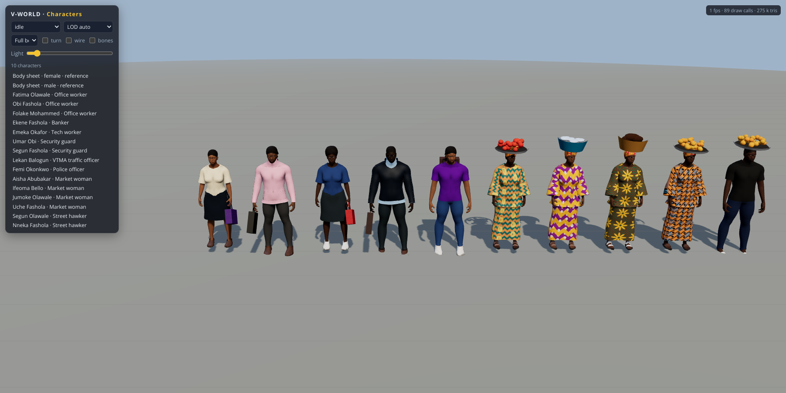 *props: head loads, bags, briefcases* |
| 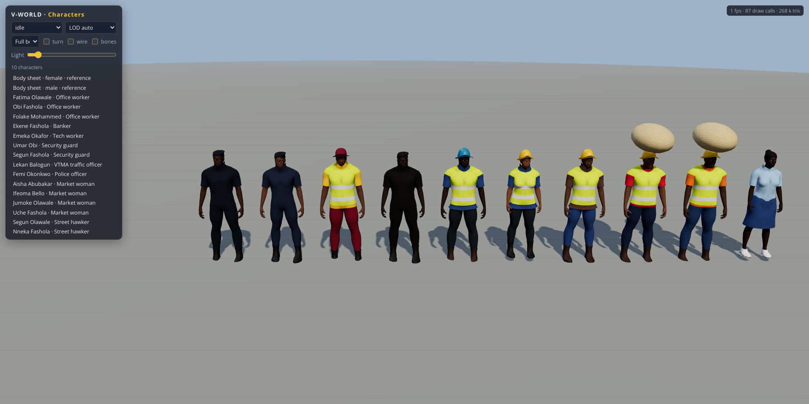 *uniforms* | 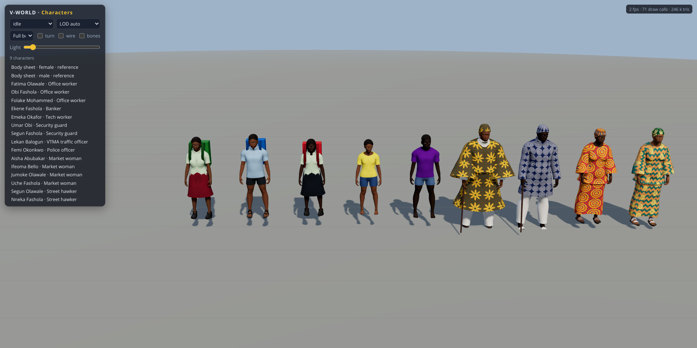 *children & elders* |
| 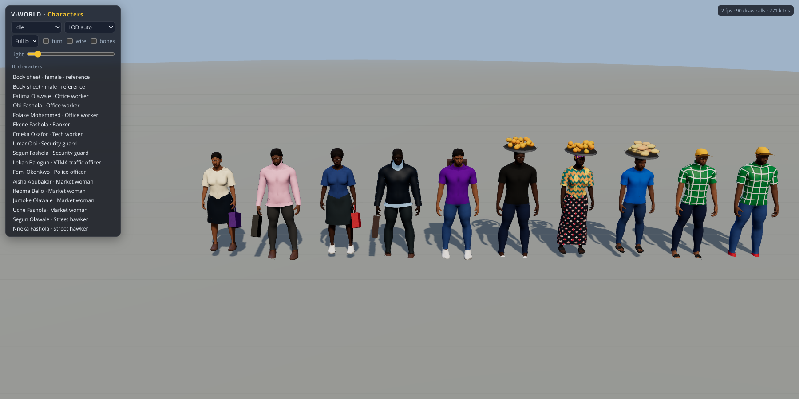 *street wear* | 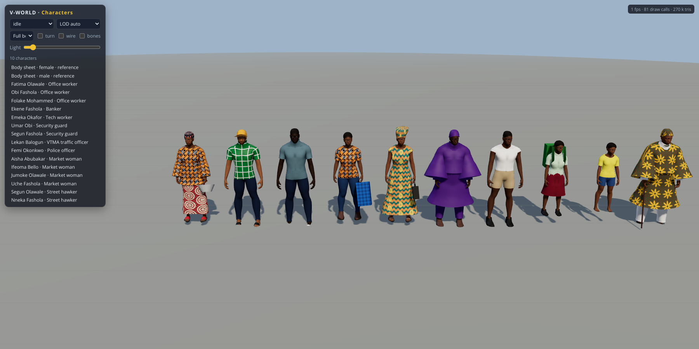 *traditional / office / transport* |
| 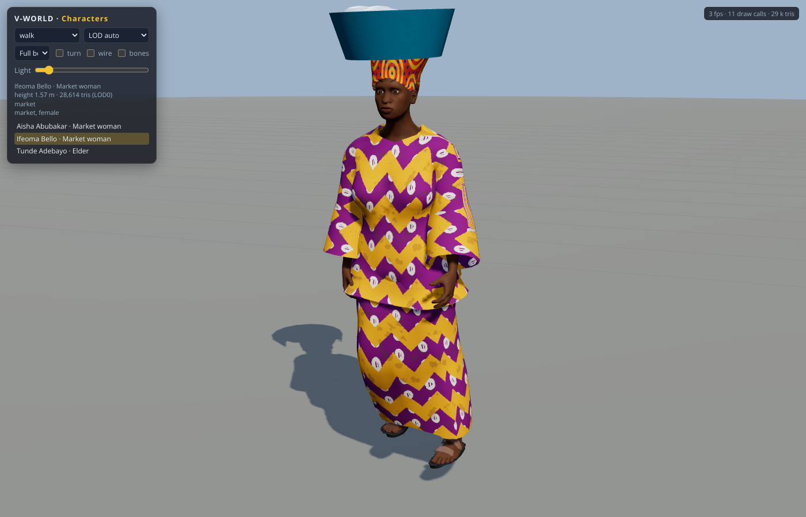 *iro & buba, gele, basin (walk_carry)* | 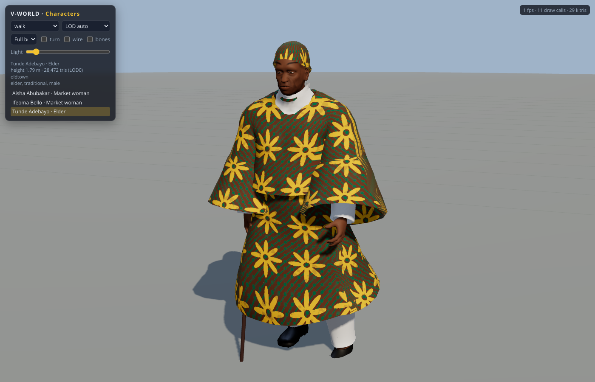 *agbada, fila, walking stick* |
| 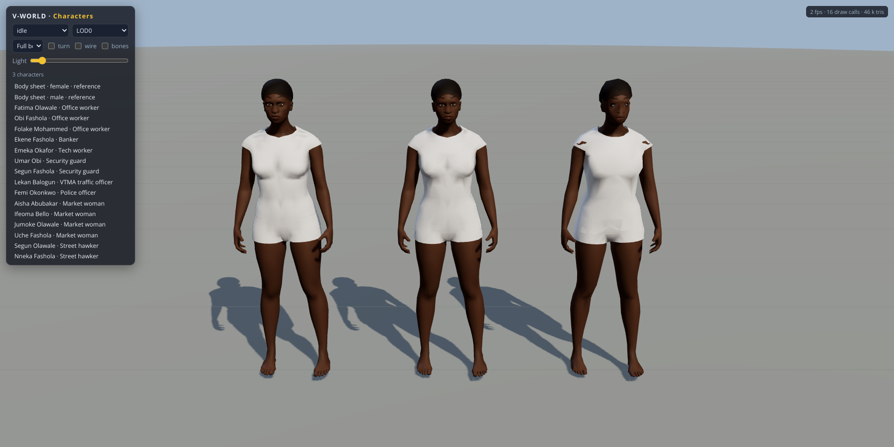 *LOD0 / LOD1 / LOD2 (27 k / 11 k / 4 k tris)* | 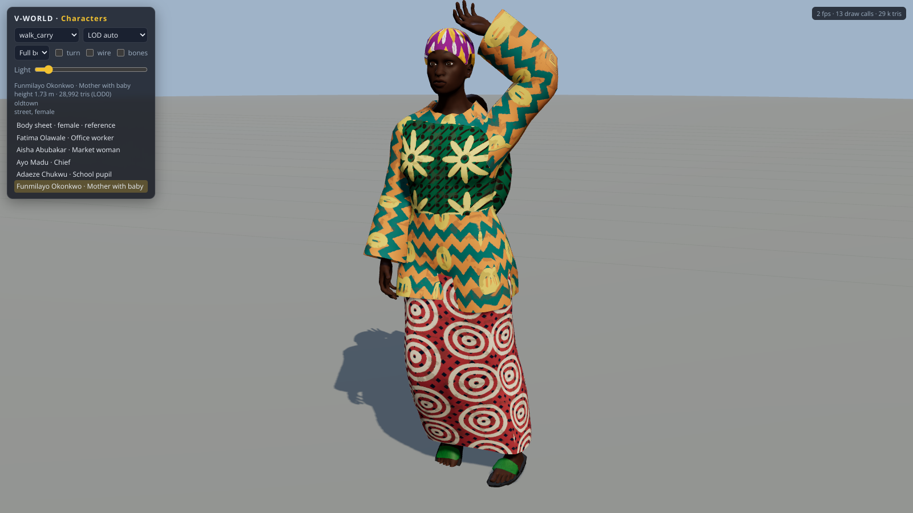 *baby wrap* |
| 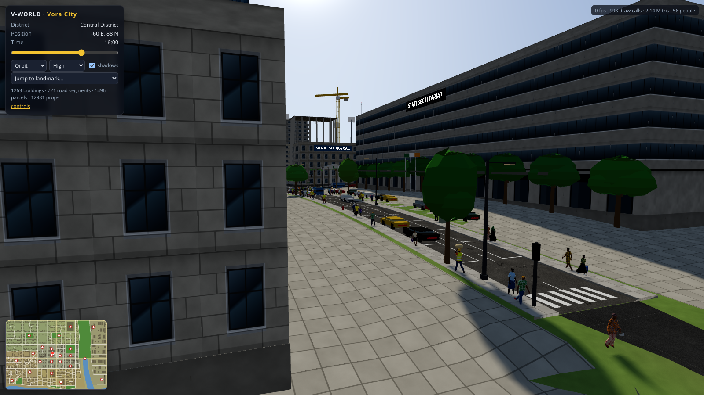 *ambient crowd on Assembly Street* | 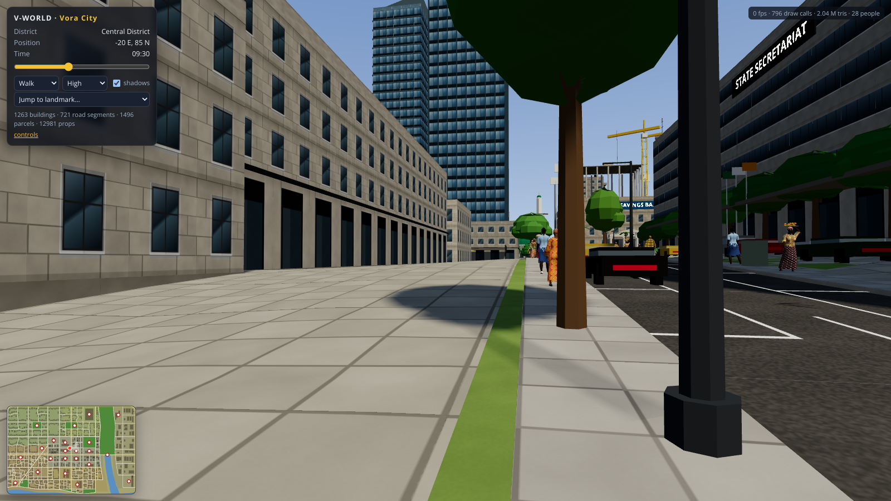 *street level, Central District* |

**Population** — `data/characters.json` (committed, deterministic, seed 20260419): 64 named people in 34 roles
(market women, hawkers, porters, office workers, bankers, police, VTMA traffic officers, security guards, nurses,
teachers, mechanics, factory workers, okada riders, danfo conductors, school pupils, elders, joggers, mothers …),
26 women / 38 men, 6 children, 4 elders; every entry has a stable id (`chr_<role>_<n>`), name, role, district
affinity, skin tone, hair, outfit, props, idle clips and a moving clip. Per character: ≈27 k / 11 k / 4 k triangles
across the LODs, 7–13 draw calls, ≈1.1 MB (the 2 body-sheet references are `body_female` / `body_male`).

**Animation** — `animations.gltf` holds 9 clips sampled at 30 fps (idle, idle_talk, walk, walk_carry, run, sit,
phone, wave, sell) authored procedurally on the reference rig with FK checks (feet stay on the ground, toes bend at
push-off); hip translation is retargeted to each character's height at load (`src/characters/retarget.ts`).

**Crowd layer** — `src/app/crowd.ts` streams a district-balanced cast into the city (8 / 16 / 24 distinct people on
low / medium / high), clones them into 30 / 64 / 120 agents that walk the sidewalk network (kerb + half a sidewalk,
right-hand side, turning at junctions, blending between sidewalk lines, occasional role-appropriate idles), recycles
agents that drift out of range onto streets whose district matches their affinity, switches the baked LODs by distance
and animates far agents at a lower rate. `?crowd=0` disables it, `?crowd=high` forces a preset.

```bash
npm run characters            # regenerate skins, fabrics, 66 characters with LODs, animations.gltf, manifest + data/characters.json (~90 s)
#   env: SKIP_TEXTURES=1 (reuse textures, ~65 s)  ONLY=id1,id2  PER_WEIGHT=2 (bigger population)  NO_LODS=1
npm run dev                   # http://localhost:5173/characters.html  (?id=<id> ?clip=walk ?view=face|hands|back ?lineup=all|id,id ?lod=0|1|2)
npm run test                  # vitest incl. tests/characters.test.ts (determinism, budgets, glTF validity, garments outside skin, feet on ground, manifest)
node scripts/shoot_characters.mjs   # headless renders → docs/screenshots/characters/  (SHOTS=…, SOLO=id, SOLO_CLIP=…)
```

Honest limits: cloth is modelled and painted, not simulated (wide sleeves swing with the arm bones); facial animation
is limited to the jaw/eye joints (no expression morphs yet); skin is painted, not scanned; the crowd is placement and
routing on sidewalks, not a life simulation (no traffic interaction, no collision avoidance between people); character
files are ~1.1 MB each uncompressed (mesh quantisation is the next size step). Generated character files are not
committed (they rebuild deterministically); all screenshots above are real headless renders of the current output.

## Running

```bash
npm install
npm run generate     # rebuild data/city.json (deterministic; ~1 s)
npm run characters   # generate the humans into public/assets/characters (gitignored; needed by the game and the crowd)
npm run dev          # game on http://localhost:5173/  · city viewer on /city.html (?q=low|medium|high &h=<hour>) · lineup on /characters.html
npm run test         # vitest: determinism, graph integrity, no buildings on roads, …
npm run typecheck
npm run build        # production bundle in dist/ (game + viewer + lineup)
npx cap sync android && (cd android && ./gradlew assembleDebug)   # local APK (JDK 21 + Android SDK); CI does this on every push
npm run map          # docs/map.png plan render (needs python3 + Pillow)
node scripts/game-shot.mjs    # headless game screenshots (title → create → wake → rooms/compound) → docs/screenshots/game  (SHOTS=…, QUALITY=…, MOBILE=1)
node scripts/screenshot.mjs   # headless Chromium (SwiftShader) city-viewer screenshots + runtime smoke test → docs/screenshots
#   env: VIEWS=stadium,night-central  QUALITY=low|medium|high  SHOT_MOBILE=1 (phone emulation)  SHOT_W/SHOT_H
```

### Viewer controls

* **Orbit / fly**: drag to orbit, right-drag to pan, wheel to zoom, `WASD` / arrows to move, `Q`/`E` down/up.
* **Walk**: `C` toggles; `WASD` + mouse look (pointer lock), `Shift` to run, `Space` to jump.
* Click a building for its inspector card (name, archetype, district, address, floors); click the minimap to travel;
  "Jump to landmark" visits authored views. The time slider drives sun, sky, fog, window lights and street lamps.
* Mobile: coarse-pointer devices get the *low* preset (no shadows, smaller atlas), pinch/pan touch controls.

## Data model (`src/shared/types.ts`)

`CityData { meta, water, districts, roads { nodes, edges, profiles }, blocks, parcels, buildings, landmarks, streets, props, stats }`

* Units are metres; `x` east, `z` south, `y` up. The city core is ≈1.64 × 1.12 km inside a 2.4 × 1.9 km terrain.
* Roads: `RoadEdge { id, a, b, cls, points, heights, length, streetId, name, bridge?, oneWay? }`; nodes carry
  `kind` (`junction | bend | end | roundabout`) and `radius`.
* Buildings: `Building { id, parcelId, blockId, districtId, archetype, use, name, address, masses[], height, floors, entrance, landmark?, tags }`
  where each mass is a rotated box with facade/roof/feature descriptors — the renderer never guesses.
* Props: `Prop { id, t, x, y, z, r, s?, v?, c?, p?, text? }` (type, pose, scale, variant, colour, params, label).
* Characters (`data/characters.json`): `{ generated, seed, animations, clips[], characters[] }` with
  `{ id, file, name, role, roleId, sex, age, height, tris, lodTris[3], bytes, tags[], district, districts[], districtNames[], skinTone, hair, headwear, outfit[{garment, fabric, colour}], props[], idle[], moving }`
  — the runtime manifest `public/assets/characters/manifest.json` is the same minus the wardrobe details.

## Scope

Phase 1 delivered the exterior world (terrain, water, roads, blocks, buildings, landmarks, public space, street detail,
materials, lighting, time-of-day, LOD/performance); Phase 2 the human assets (bodies, wardrobe, hair, props,
animation clips, population manifest) and an ambient sidewalk crowd; Phase 3 turns it into the game, milestone by
milestone — **APK 1 App + Home** (this build) → APK 2 Alive (mocap, schedules, traffic, animated world, cinematic) →
APK 3 Ride & earn → APK 4 Wanted (police, arrests) → APK 5 Story, then multiplayer and player houses. Details and the
honest list of limitations: `docs/GAME.md`; earlier phases: `docs/REPORT.md`, `docs/CHARACTERS.md`.
