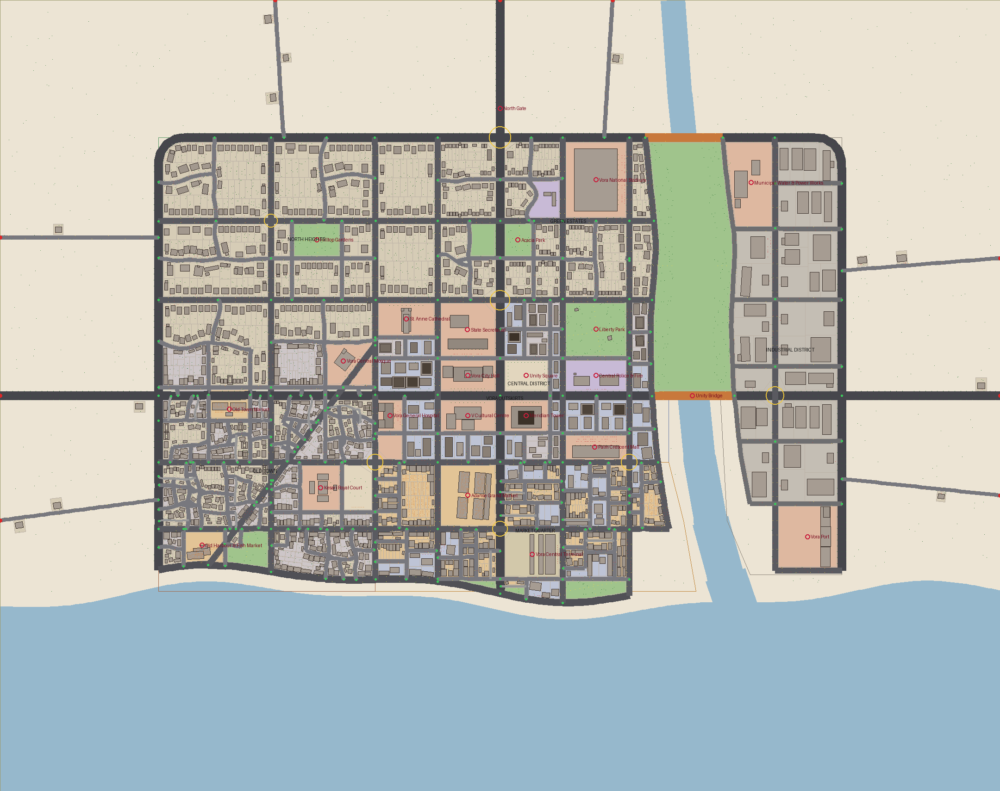
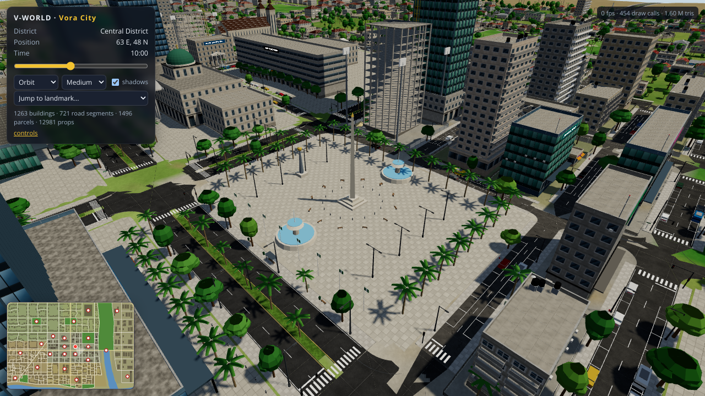
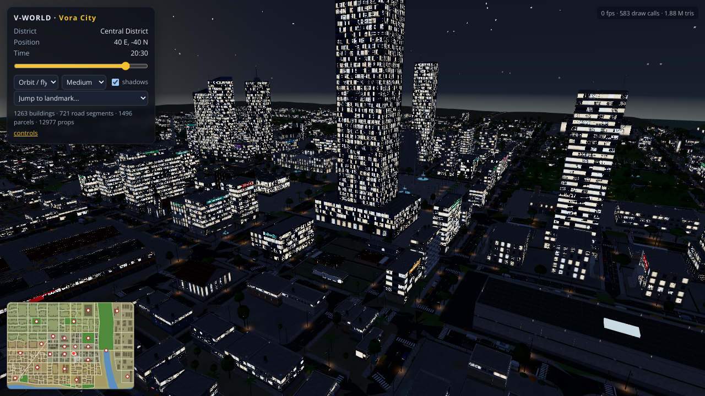
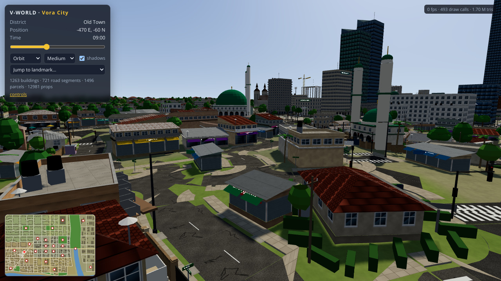
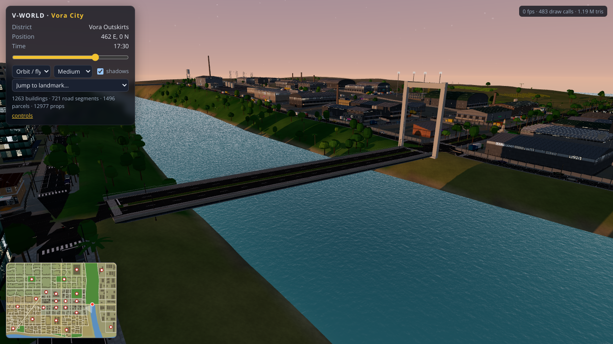

# V-WORLD · Vora City

A continuous, data-driven 3D city for the fictional West-African-inspired country **V**. This repository holds the
*physical foundation* of the world — terrain, water, a connected road network, blocks and parcels, ~1,260 buildings in
six districts, 23 landmarks and ~13,000 pieces of street detail — as a real project (generator + data + renderer),
not a single HTML file.



| | |
|---|---|
|  |  |
|  |  |

## How it is built

```
generator/  (Node, TypeScript)  ──►  data/city.json  ──►  src/app/ (Vite + three.js viewer)
```

1. **`npm run generate`** runs the deterministic, seeded generator (`generator/index.ts`) and bakes
   `data/city.json` (≈2.7 MB): terrain parameters, water, districts, the road graph (nodes/edges with classes, names,
   heights, bridges, roundabouts), blocks, parcels, buildings (massing + facade/roof/feature descriptions), landmarks
   (with camera views) and props. Every entity has a **stable id, type, position and district**, so gameplay,
   traffic, NPCs or an economy layer can be attached later without touching the world.
2. **`npm run dev`** serves the viewer. It builds all geometry at load time from the JSON (procedural texture atlas,
   chunked merged meshes, instanced props, LOD/culling, one cascaded-free shadow map, time-of-day sky) — no external
   assets are downloaded.

### Construction order (matches the master plan)

| Stage | Where | What |
|---|---|---|
| 1 Audit | `docs/REPORT.md` | findings on the legacy demo (`legacy/`) and what was replaced |
| 2 Layout | `generator/config.ts` | district polygons, authored skeleton roads, reserved landmark sites, roundabouts, bridges |
| 3 Roads | `generator/graph.ts`, `generator/roads.ts`, `src/shared/roadgeom.ts`, `src/app/world/roads.ts` | planar graph (intersections, snapping, duplicate removal), hierarchy (arterial / secondary / local / lane / service / waterfront), junction geometry, markings, crossings, kerbs, medians, drains, bridges |
| 4 Blocks & parcels | `generator/blocks.ts`, `generator/parcels.ts` | faces → blocks, corridor insets (building line), frontage-aware subdivision, setbacks, fences/gates, addresses |
| 5 Major architecture | `generator/landmarks.ts` | 23 authored landmarks sized to their sites (City Hall, Meridian Tower, Grand Market, Stadium, Cathedral, Mosque, Royal Court, Port, Terminal, Bridge, …) |
| 6 Neighbourhood architecture | `generator/archetypes.ts`, `generator/buildings.ts` | 49 archetypes with parcel-relative massing, facades, roofs and features (balconies, canopies, columns, tanks, AC units, signs, …) |
| 7 Public spaces | `generator/landmarks.ts` (`parkProps`), `generator/props.ts` | squares, parks, playgrounds, pitches, markets, quays |
| 8 Street detail | `generator/props.ts`, `src/app/world/props.ts` | lamps, trees, benches, bins, signals, stop/street-name/directional signs, bus shelters, bollards, parking bays, vendors, kiosks, wires, manholes, roadworks, construction sites, vehicles |
| 9 Refinement | `src/app/atlas.ts`, `src/app/materials.ts`, `src/app/sky.ts` | consistent materials, lighting, time-of-day, night windows and lamp pools |
| 10 Optimisation & verification | `src/app/main.ts`, `tests/`, `scripts/screenshot.mjs` | quality presets, chunking, instancing, LOD, headless render + tests |

## Running

```bash
npm install
npm run generate     # rebuild data/city.json (deterministic; ~1 s)
npm run dev          # viewer on http://localhost:5173  (?q=low|medium|high  &h=<hour>)
npm run test         # vitest: determinism, graph integrity, no buildings on roads, …
npm run typecheck
npm run build        # production bundle in dist/
npm run map          # docs/map.png plan render (needs python3 + Pillow)
node scripts/screenshot.mjs   # headless Chromium (SwiftShader) screenshots + runtime smoke test → docs/screenshots
```

### Viewer controls

* **Orbit / fly**: drag to orbit, right-drag to pan, wheel to zoom, `WASD` / arrows to move, `Q`/`E` down/up.
* **Walk**: `C` toggles; `WASD` + mouse look (pointer lock), `Shift` to run, `Space` to jump.
* Click a building for its inspector card (name, archetype, district, address, floors); click the minimap to travel;
  "Jump to landmark" visits authored views. The time slider drives sun, sky, fog, window lights and street lamps.
* Mobile: coarse-pointer devices get the *low* preset (no shadows, smaller atlas), pinch/pan touch controls.

## Data model (`src/shared/types.ts`)

`CityData { meta, water, districts, roads { nodes, edges, profiles }, blocks, parcels, buildings, landmarks, streets, props, stats }`

* Units are metres; `x` east, `z` south, `y` up. The city core is ≈1.64 × 1.12 km inside a 2.4 × 1.9 km terrain.
* Roads: `RoadEdge { id, a, b, cls, points, heights, length, streetId, name, bridge?, oneWay? }`; nodes carry
  `kind` (`junction | bend | end | roundabout`) and `radius`.
* Buildings: `Building { id, parcelId, blockId, districtId, archetype, use, name, address, masses[], height, floors, entrance, landmark?, tags }`
  where each mass is a rotated box with facade/roof/feature descriptors — the renderer never guesses.
* Props: `Prop { id, t, x, y, z, r, s?, v?, c?, p?, text? }` (type, pose, scale, variant, colour, params, label).

## Scope

In scope: the exterior world (terrain, water, roads, blocks, buildings, landmarks, public space, street detail,
materials, lighting, time-of-day, LOD/performance). Out of scope for this stage and deliberately left as clean
extension points: interiors, gameplay, economy, multiplayer, NPC simulation, missions and traffic AI.
See `docs/REPORT.md` for the change log, verification results and known limitations.
